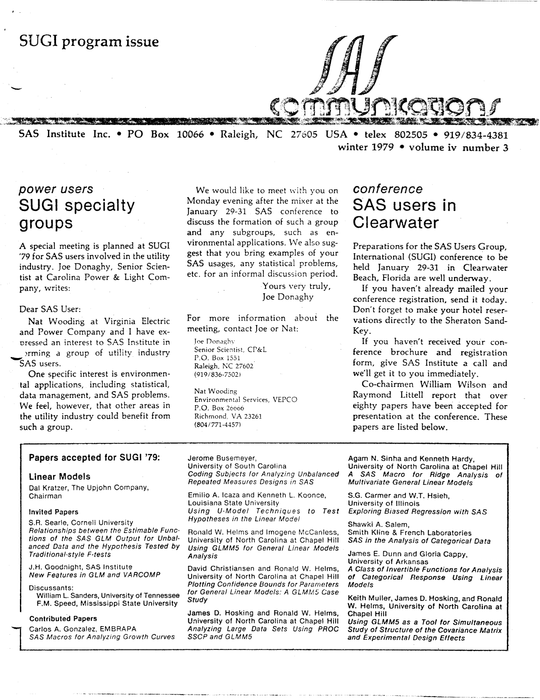
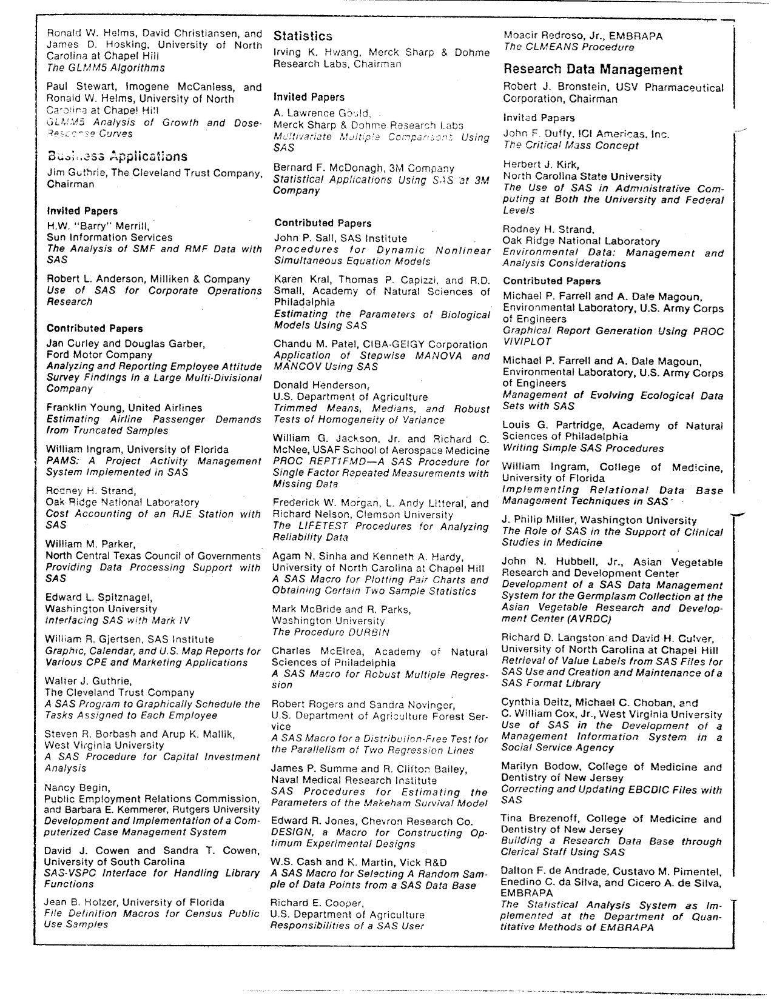
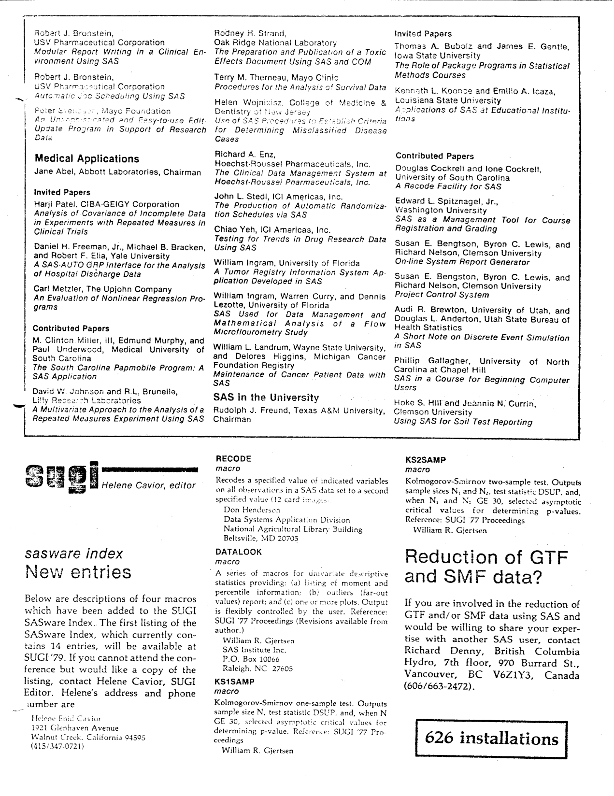
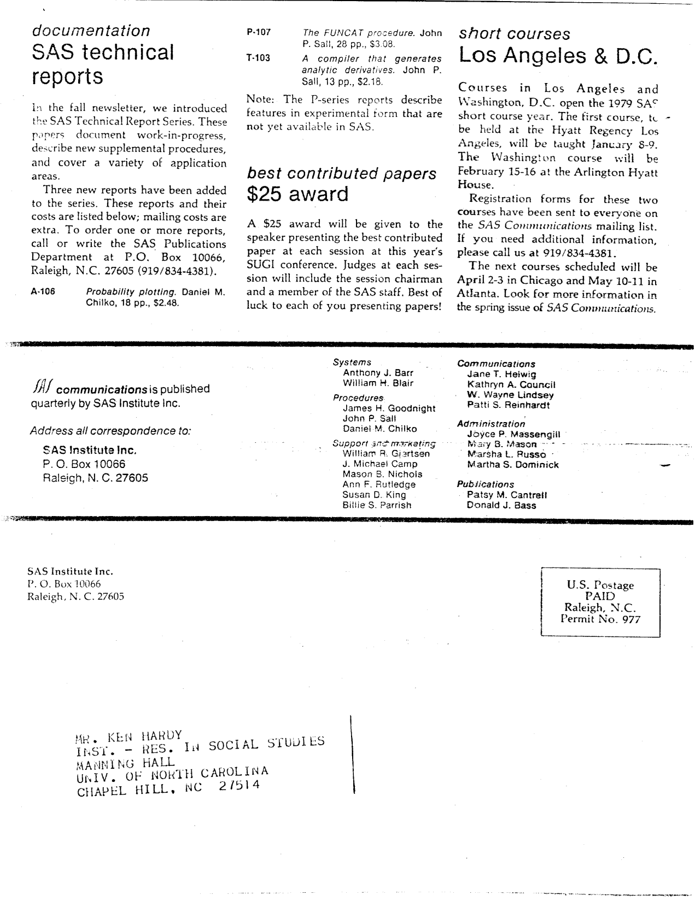

The third issue of Volume IV of "SAS Communications" was published in Winter 1979 as the SUGI '79 program issue, with the conference at Clearwater Beach a few weeks away. Highlights include the full list of over eighty papers accepted for SUGI '79, session by session, with every chairman and author; a proposal from Joe Donaghy of Carolina Power & Light and Nat Wooding of VEPCO to form a utility-industry SAS users group; four new macros in the SUGI SASware index (RECODE, DATALOOK, KS1SAMP and KS2SAMP); three new SAS Technical Reports (A-106, P-107 and T-103); a $25 award for the best contributed paper at each session; the 1979 short course year in Los Angeles, Washington, Chicago and Atlanta; a call for anyone reducing GTF or SMF data with SAS to share their expertise; and a report of 626 SAS installations. The original is <a href="../resources/SAS_Communications_issue_15.pdf" target="_blank">here</a>.

# **SAS Communications**

**Vol. IV, No. 3**  
**Winter 1979**

---

## **SUGI Specialty Groups**

*Power users*

A special meeting is planned at SUGI '79 for SAS users involved in the utility industry. Joe Donaghy, Senior Scientist at Carolina Power & Light Company, writes:

Dear SAS User:

Nat Wooding at Virginia Electric and Power Company and I have expressed an interest to SAS Institute in forming a group of utility industry SAS users.

One specific interest is environmental applications, including statistical, data management, and SAS problems. We feel, however, that other areas in the utility industry could benefit from such a group.

We would like to meet with you on Monday evening after the mixer at the January 29-31 SAS conference to discuss the formation of such a group and any subgroups, such as environmental applications. We also suggest that you bring examples of your SAS usages, any statistical problems, etc. for an informal discussion period.

Yours very truly,

Joe Donaghy

For more information about the meeting, contact Joe or Nat:

Joe Donaghy  
Senior Scientist, CP&L  
P.O. Box 1551  
Raleigh, NC 27602  
(919/836-7502)

Nat Wooding  
Environmental Services, VEPCO  
P.O. Box 26606  
Richmond, VA 23261  
(804/771-4457)

## **SAS Users In Clearwater**

*Conference*

Preparations for the SAS Users Group, International (SUGI) conference to be held January 29-31 in Clearwater Beach, Florida are well underway.

If you haven't already mailed your conference registration, send it today. Don't forget to make your hotel reservations directly to the Sheraton Sand-Key.

If you haven't received your conference brochure and registration form, give SAS Institute a call and we'll get it to you immediately.

Co-chairmen William Wilson and Raymond Littell report that over eighty papers have been accepted for presentation at the conference. These papers are listed below.

## **Papers Accepted For SUGI '79**

### **Linear Models**

Dal Kratzer, The Upjohn Company, Chairman

**Invited Papers**

S.R. Searle, Cornell University  
*Relationships between the Estimable Functions of the SAS GLM Output for Unbalanced Data and the Hypothesis Tested by Traditional-style F-tests*

J.H. Goodnight, SAS Institute  
*New Features in GLM and VARCOMP*

Discussants: William L. Sanders, University of Tennessee; F.M. Speed, Mississippi State University

**Contributed Papers**

Carlos A. Gonzalez, EMBRAPA  
*SAS Macros for Analyzing Growth Curves*

Jerome Busemeyer, University of South Carolina  
*Coding Subjects for Analyzing Unbalanced Repeated Measures Designs in SAS*

Emilio A. Icaza and Kenneth L. Koonce, Louisiana State University  
*Using U-Model Techniques to Test Hypotheses in the Linear Model*

Ronald W. Helms and Imogene McCanless, University of North Carolina at Chapel Hill  
*Using GLMM5 for General Linear Models Analysis*

David Christiansen and Ronald W. Helms, University of North Carolina at Chapel Hill  
*Plotting Confidence Bounds for Parameters for General Linear Models: A GLMM5 Case Study*

James D. Hosking and Ronald W. Helms, University of North Carolina at Chapel Hill  
*Analyzing Large Data Sets Using PROC SSCP and GLMM5*

Agam N. Sinha and Kenneth Hardy, University of North Carolina at Chapel Hill  
*A SAS Macro for Ridge Analysis of Multivariate General Linear Models*

S.G. Carmer and W.T. Hsieh, University of Illinois  
*Exploring Biased Regression with SAS*

Shawki A. Salem, Smith Kline & French Laboratories  
*SAS in the Analysis of Categorical Data*

James E. Dunn and Gloria Cappy, University of Arkansas  
*A Class of Invertible Functions for Analysis of Categorical Response Using Linear Models*

Keith Muller, James D. Hosking, and Ronald W. Helms, University of North Carolina at Chapel Hill  
*Using GLMM5 as a Tool for Simultaneous Study of Structure of the Covariance Matrix and Experimental Design Effects*

---

Ronald W. Helms, David Christiansen, and James D. Hosking, University of North Carolina at Chapel Hill  
*The GLMM5 Algorithms*

Paul Stewart, Imogene McCanless, and Ronald W. Helms, University of North Carolina at Chapel Hill  
*GLMM5 Analysis of Growth and Dose-Response Curves*

### **Business Applications**

Jim Guthrie, The Cleveland Trust Company, Chairman

**Invited Papers**

H.W. "Barry" Merrill, Sun Information Services  
*The Analysis of SMF and RMF Data with SAS*

Robert L. Anderson, Milliken & Company  
*Use of SAS for Corporate Operations Research*

**Contributed Papers**

Jan Curley and Douglas Garber, Ford Motor Company  
*Analyzing and Reporting Employee Attitude Survey Findings in a Large Multi-Divisional Company*

Franklin Young, United Airlines  
*Estimating Airline Passenger Demands from Truncated Samples*

William Ingram, University of Florida  
*PAMS: A Project Activity Management System Implemented in SAS*

Rodney H. Strand, Oak Ridge National Laboratory  
*Cost Accounting of an RJE Station with SAS*

William M. Parker, North Central Texas Council of Governments  
*Providing Data Processing Support with SAS*

Edward L. Spitznagel, Washington University  
*Interfacing SAS with Mark IV*

William R. Gjertsen, SAS Institute  
*Graphic, Calendar, and U.S. Map Reports for Various CPE and Marketing Applications*

Walter J. Guthrie, The Cleveland Trust Company  
*A SAS Program to Graphically Schedule the Tasks Assigned to Each Employee*

Steven R. Borbash and Arup K. Mallik, West Virginia University  
*A SAS Procedure for Capital Investment Analysis*

Nancy Begin, Public Employment Relations Commission, and Barbara E. Kemmerer, Rutgers University  
*Development and Implementation of a Computerized Case Management System*

David J. Cowen and Sandra T. Cowen, University of South Carolina  
*SAS-VSPC Interface for Handling Library Functions*

Jean B. Holzer, University of Florida  
*File Definition Macros for Census Public Use Samples*

### **Statistics**

Irving K. Hwang, Merck Sharp & Dohme Research Labs, Chairman

**Invited Papers**

A. Lawrence Gould, Merck Sharp & Dohme Research Labs  
*Multivariate Multiple Comparisons Using SAS*

Bernard F. McDonagh, 3M Company  
*Statistical Applications Using SAS at 3M Company*

**Contributed Papers**

John P. Sall, SAS Institute  
*Procedures for Dynamic Nonlinear Simultaneous Equation Models*

Karen Kral, Thomas P. Capizzi, and R.D. Small, Academy of Natural Sciences of Philadelphia  
*Estimating the Parameters of Biological Models Using SAS*

Chandu M. Patel, CIBA-GEIGY Corporation  
*Application of Stepwise MANOVA and MANCOV Using SAS*

Donald Henderson, U.S. Department of Agriculture  
*Trimmed Means, Medians, and Robust Tests of Homogeneity of Variance*

William G. Jackson, Jr. and Richard C. McNee, USAF School of Aerospace Medicine  
*PROC REPTIFMD - A SAS Procedure for Single Factor Repeated Measurements with Missing Data*

Frederick W. Morgan, L. Andy Litteral, and Richard Nelson, Clemson University  
*The LIFETEST Procedures for Analyzing Reliability Data*

Agam N. Sinha and Kenneth A. Hardy, University of North Carolina at Chapel Hill  
*A SAS Macro for Plotting Pair Charts and Obtaining Certain Two Sample Statistics*

Mark McBride and R. Parks, Washington University  
*The Procedure DURBIN*

Charles McElrea, Academy of Natural Sciences of Philadelphia  
*A SAS Macro for Robust Multiple Regression*

Robert Rogers and Sandra Novinger, U.S. Department of Agriculture Forest Service  
*A SAS Macro for a Distribution-Free Test for the Parallelism of Two Regression Lines*

James P. Summe and R. Clifton Bailey, Naval Medical Research Institute  
*SAS Procedures for Estimating the Parameters of the Makeham Survival Model*

Edward R. Jones, Chevron Research Co.  
*DESIGN, a Macro for Constructing Optimum Experimental Designs*

W.S. Cash and K. Martin, Vick R&D  
*A SAS Macro for Selecting A Random Sample of Data Points from a SAS Data Base*

Richard E. Cooper, U.S. Department of Agriculture  
*Responsibilities of a SAS User*

Moacir Redroso, Jr., EMBRAPA  
*The CLMEANS Procedure*

### **Research Data Management**

Robert J. Bronstein, USV Pharmaceutical Corporation, Chairman

**Invited Papers**

John F. Duffy, ICI Americas, Inc.  
*The Critical Mass Concept*

Herbert J. Kirk, North Carolina State University  
*The Use of SAS in Administrative Computing at Both the University and Federal Levels*

Rodney H. Strand, Oak Ridge National Laboratory  
*Environmental Data: Management and Analysis Considerations*

**Contributed Papers**

Michael P. Farrell and A. Dale Magoun, Environmental Laboratory, U.S. Army Corps of Engineers  
*Graphical Report Generation Using PROC VIVIPLOT*

Michael P. Farrell and A. Dale Magoun, Environmental Laboratory, U.S. Army Corps of Engineers  
*Management of Evolving Ecological Data Sets with SAS*

Louis G. Partridge, Academy of Natural Sciences of Philadelphia  
*Writing Simple SAS Procedures*

William Ingram, College of Medicine, University of Florida  
*Implementing Relational Data Base Management Techniques in SAS*

J. Philip Miller, Washington University  
*The Role of SAS in the Support of Clinical Studies in Medicine*

John N. Hubbell, Jr., Asian Vegetable Research and Development Center  
*Development of a SAS Data Management System for the Germplasm Collection at the Asian Vegetable Research and Development Center (AVRDC)*

Richard D. Langston and David H. Culver, University of North Carolina at Chapel Hill  
*Retrieval of Value Labels from SAS Files for SAS Use and Creation and Maintenance of a SAS Format Library*

Cynthia Deitz, Michael C. Choban, and C. William Cox, Jr., West Virginia University  
*Use of SAS in the Development of a Management Information System in a Social Service Agency*

Marilyn Bodow, College of Medicine and Dentistry of New Jersey  
*Correcting and Updating EBCDIC Files with SAS*

Tina Brezenoff, College of Medicine and Dentistry of New Jersey  
*Building a Research Data Base through Clerical Staff Using SAS*

Dalton F. de Andrade, Custavo M. Pimentel, Enedino C. da Silva, and Cicero A. de Silva, EMBRAPA  
*The Statistical Analysis System as Implemented at the Department of Quantitative Methods of EMBRAPA*

---

Robert J. Bronstein, USV Pharmaceutical Corporation  
*Modular Report Writing in a Clinical Environment Using SAS*

Robert J. Bronstein, USV Pharmaceutical Corporation  
*Automatic Scheduling Using SAS*

Peter Svensson, Mayo Foundation  
*An Uncomplicated and Easy-to-use Edit/Update Program in Support of Research Data*

### **Medical Applications**

Jane Abel, Abbott Laboratories, Chairman

**Invited Papers**

Harji Patel, CIBA-GEIGY Corporation  
*Analysis of Covariance of Incomplete Data in Experiments with Repeated Measures in Clinical Trials*

Daniel H. Freeman, Jr., Michael B. Bracken, and Robert F. Elia, Yale University  
*A SAS-AUTO GRP Interface for the Analysis of Hospital Discharge Data*

Carl Metzler, The Upjohn Company  
*An Evaluation of Nonlinear Regression Programs*

**Contributed Papers**

M. Clinton Miller, III, Edmund Murphy, and Paul Underwood, Medical University of South Carolina  
*The South Carolina Papmobile Program: A SAS Application*

David W. Johnson and R.L. Brunelle, Lilly Research Laboratories  
*A Multivariate Approach to the Analysis of a Repeated Measures Experiment Using SAS*

Rodney H. Strand, Oak Ridge National Laboratory  
*The Preparation and Publication of a Toxic Effects Document Using SAS and COM*

Terry M. Therneau, Mayo Clinic  
*Procedures for the Analysis of Survival Data*

Helen Wojnixisz, College of Medicine & Dentistry of New Jersey  
*Use of SAS Procedures to Establish Criteria for Determining Misclassified Disease Cases*

Richard A. Enz, Hoechst-Roussel Pharmaceuticals, Inc.  
*The Clinical Data Management System at Hoechst-Roussel Pharmaceuticals, Inc.*

John L. Stedl, ICI Americas, Inc.  
*The Production of Automatic Randomization Schedules via SAS*

Chiao Yeh, ICI Americas, Inc.  
*Testing for Trends in Drug Research Data Using SAS*

William Ingram, University of Florida  
*A Tumor Registry Information System Application Developed in SAS*

William Ingram, Warren Curry, and Dennis Lezotte, University of Florida  
*SAS Used for Data Management and Mathematical Analysis of a Flow Microflourometry Study*

William L. Landrum, Wayne State University, and Delores Higgins, Michigan Cancer Foundation Registry  
*Maintenance of Cancer Patient Data with SAS*

### **SAS In The University**

Rudolph J. Freund, Texas A&M University, Chairman

**Invited Papers**

Thomas A. Bubolz and James E. Gentle, Iowa State University  
*The Role of Package Programs in Statistical Methods Courses*

Kenneth L. Koonce and Emilio A. Icaza, Louisiana State University  
*Applications of SAS at Educational Institutions*

**Contributed Papers**

Douglas Cockrell and Ione Cockrell, University of South Carolina  
*A Recode Facility for SAS*

Edward L. Spitznagel, Jr., Washington University  
*SAS as a Management Tool for Course Registration and Grading*

Susan E. Bengtson, Byron C. Lewis, and Richard Nelson, Clemson University  
*On-line System Report Generator*

Susan E. Bengtson, Byron C. Lewis, and Richard Nelson, Clemson University  
*Project Control System*

Audi R. Brewton, University of Utah, and Douglas L. Anderton, Utah State Bureau of Health Statistics  
*A Short Note on Discrete Event Simulation in SAS*

Phillip Gallagher, University of North Carolina at Chapel Hill  
*SAS in a Course for Beginning Computer Users*

Hoke S. Hill and Jeannie N. Currin, Clemson University  
*Using SAS for Soil Test Reporting*

## **SASware Index**

*New entries*

Below are descriptions of four macros which have been added to the SUGI SASware Index. The first listing of the SASware Index, which currently contains 14 entries, will be available at SUGI'79. If you cannot attend the conference but would like a copy of the listing, contact Helene Cavior, SUGI Editor. Helene's address and phone number are

Helene Enid Cavior  
1921 Glenhaven Avenue  
Walnut Creek, California 94595  
(415/347-0721)

**RECODE** macro

Recodes a specified value of indicated variables on all observations in a SAS data set to a second specified value (12 card images)

Don Henderson  
Data Systems Application Division  
National Agricultural Library Building  
Beltsville, MD 20705

**DATALOOK** macro

A series of macros for Univariate descriptive statistics providing: (a) listing of moment and percentile information; (b) outliers (far-out values) report; and (c) one or more plots. Output is flexibly controlled by the user. Reference: SUGI '77 Proceedings (Revisions available from author.)

William R. Gjertsen  
SAS Institute Inc.  
P.O. Box 10066  
Raleigh, NC 27605

**KS1SAMP** macro

Kolmogorov-Smirnov one-sample test. Outputs sample size N, test statistic DSUP, and, when N GE 30, selected asymptotic critical values for determining p-value. Reference: SUGI '77 Proceedings

William R. Gjertsen

**KS2SAMP** macro

Kolmogorov-Smirnov two-sample test. Outputs sample sizes N1 and N2, test statistic DSUP, and, when N1 and N2 GE 30, selected asymptotic critical values for determining p-values. Reference: SUGI '77 Proceedings

William R. Gjertsen

## **Reduction Of GTF And SMF Data**

If you are involved in the reduction of GTF and/or SMF data using SAS and would be willing to share your expertise with another SAS user, contact Richard Denny, British Columbia Hydro, 7th floor, 970 Burrard St., Vancouver, BC V6Z1Y3, Canada (606/663-2472).

**626 installations**

---

## **SAS Technical Reports**

*Documentation*

In the fall newsletter, we introduced the SAS Technical Report Series. These papers document work-in-progress, describe new supplemental procedures, and cover a variety of application areas.

Three new reports have been added to the series. These reports and their costs are listed below; mailing costs are extra. To order one or more reports, call or write the SAS Publications Department at P.O. Box 10066, Raleigh, N.C. 27605 (919/834-4381).

A-106 *Probability plotting.* Daniel M. Chilko, 18 pp., $2.48.

P-107 *The FUNCAT procedure.* John P. Sall, 28 pp., $3.08.

T-103 *A compiler that generates analytic derivatives.* John P. Sall, 13 pp., $2.18.

Note: The P-series reports describe features in experimental form that are not yet available in SAS.

## **$25 Award**

*Best contributed papers*

A $25 award will be given to the speaker presenting the best contributed paper at each session at this year's SUGI conference. Judges at each session will include the session chairman and a member of the SAS staff. Best of luck to each of you presenting papers!

## **Short Courses**

*Los Angeles & D.C.*

Courses in Los Angeles and Washington, D.C. open the 1979 SAS short course year. The first course, to be held at the Hyatt Regency Los Angeles, will be taught January 8-9. The Washington course will be February 15-16 at the Arlington Hyatt House.

Registration forms for these two courses have been sent to everyone on the SAS Communications mailing list. If you need additional information, please call us at 919/834-4381.

The next courses scheduled will be April 2-3 in Chicago and May 10-11 in Atlanta. Look for more information in the spring issue of SAS Communications.

---

SAS Communications is published quarterly by SAS Institute Inc.

Anthony J. Barr, Systems  
William H. Blair, Systems  
James H. Goodnight, Procedures  
John P. Sall, Procedures  
Daniel M. Chilko, Procedures  
William R. Gjertsen, Support and marketing  
J. Michael Camp, Support and marketing  
Mason E. Nichols, Support and marketing  
Ann F. Rutledge, Support and marketing  
Susan D. King, Support and marketing  
Billie S. Parrish, Support and marketing  
Jane T. Helwig, Communications  
Kathryn A. Council, Communications  
W. Wayne Lindsey, Communications  
Patti S. Reinhardt, Communications  
Joyce P. Massengill, Administration  
Mary B. Mason, Administration  
Marsha L. Russo, Administration  
Martha S. Dominick, Administration  
Patsy M. Cantrell, Publications  
Donald J. Bass, Publications

Address all correspondence to SAS Institute Inc., Post Office Box 10066, Raleigh, NC 27605.

---

SAS Institute Inc. - Post Office Box 10066 - Raleigh, North Carolina 27605 - (919) 834-4381

<!--
Winter 1979 - the SUGI '79 program issue, printed weeks before the conference opened in Clearwater Beach.

More than eighty papers were accepted for SUGI '79, and this issue prints the lot: six sessions, their chairmen, and every invited and contributed paper. It is a useful census of what SAS users were doing in 1979 - the University of North Carolina at Chapel Hill alone contributes a dozen papers on GLMM5 and PROC SSCP, while EMBRAPA, the Brazilian agricultural research corporation, has three.

Joe Donaghy of Carolina Power & Light and Nat Wooding of VEPCO use the issue to propose a utility-industry SAS users group, meeting on the Monday evening after the mixer, with environmental applications as the first subgroup.

The SUGI SASware index adds four macros: RECODE (recodes a value of indicated variables across all observations, 12 card images), DATALOOK (univariate descriptives with moment and percentile listings, an outliers report and plots), and KS1SAMP and KS2SAMP (one- and two-sample Kolmogorov-Smirnov tests). The index stands at 14 entries and its first listing will be handed out at the conference.

Elsewhere: three new SAS Technical Reports (A-106 Probability plotting by Dan Chilko at $2.48, P-107 The FUNCAT procedure by John Sall at $3.08 and T-103 A compiler that generates analytic derivatives at $2.18), a $25 award for the best contributed paper at each session, the 1979 short course year opening in Los Angeles and Washington, a request from Richard Denny of British Columbia Hydro for anyone else reducing GTF or SMF data with SAS, and a report of 626 SAS installations.

Transcribed from the original newsletter, published by SAS Institute Inc., for historical interest.

#sas #sugi #sugi79 #procglm #lifetest #vivplot #statisticalsoftware #techhistory #retrocomputing #sasinstitute
-->
