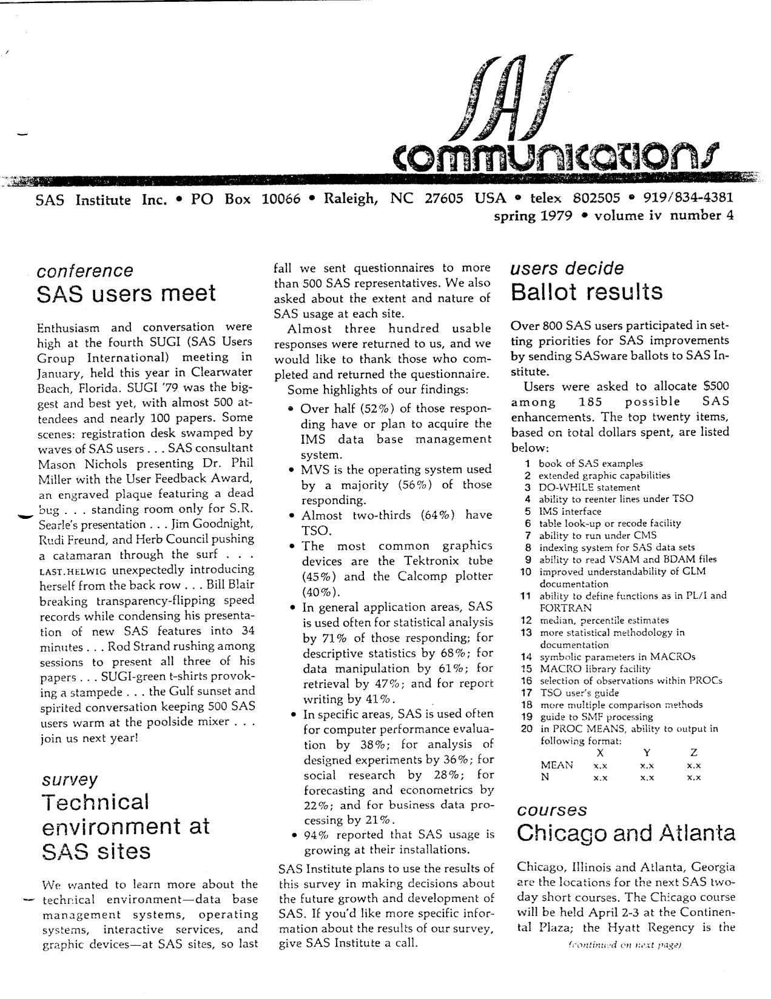
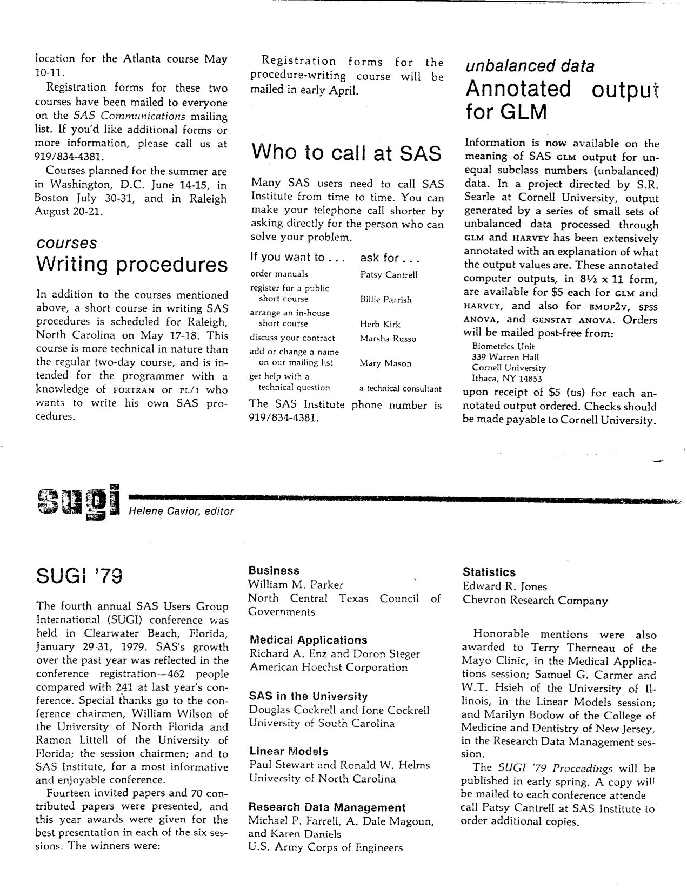
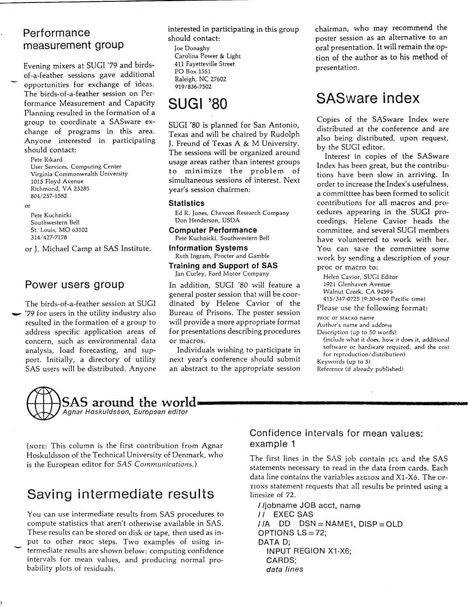
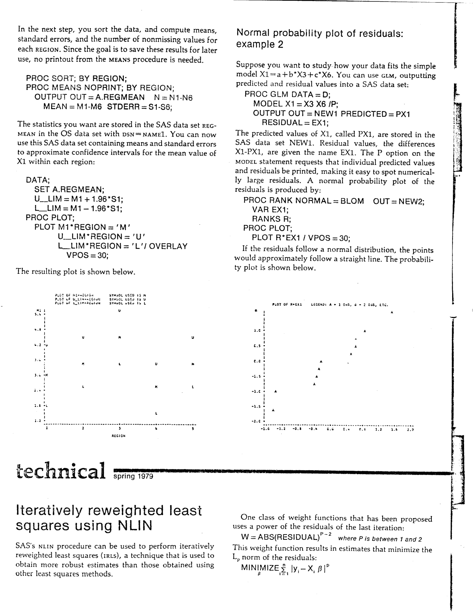
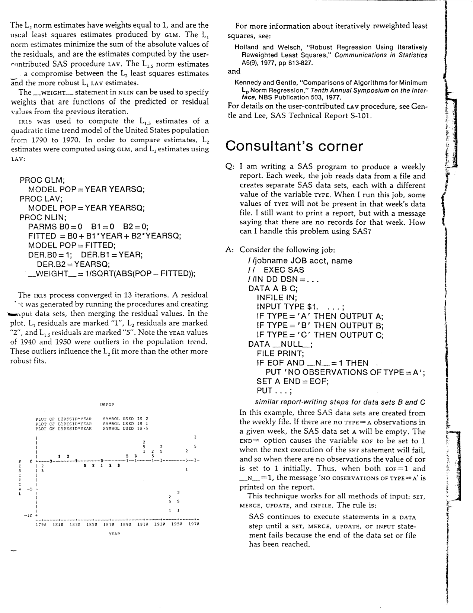
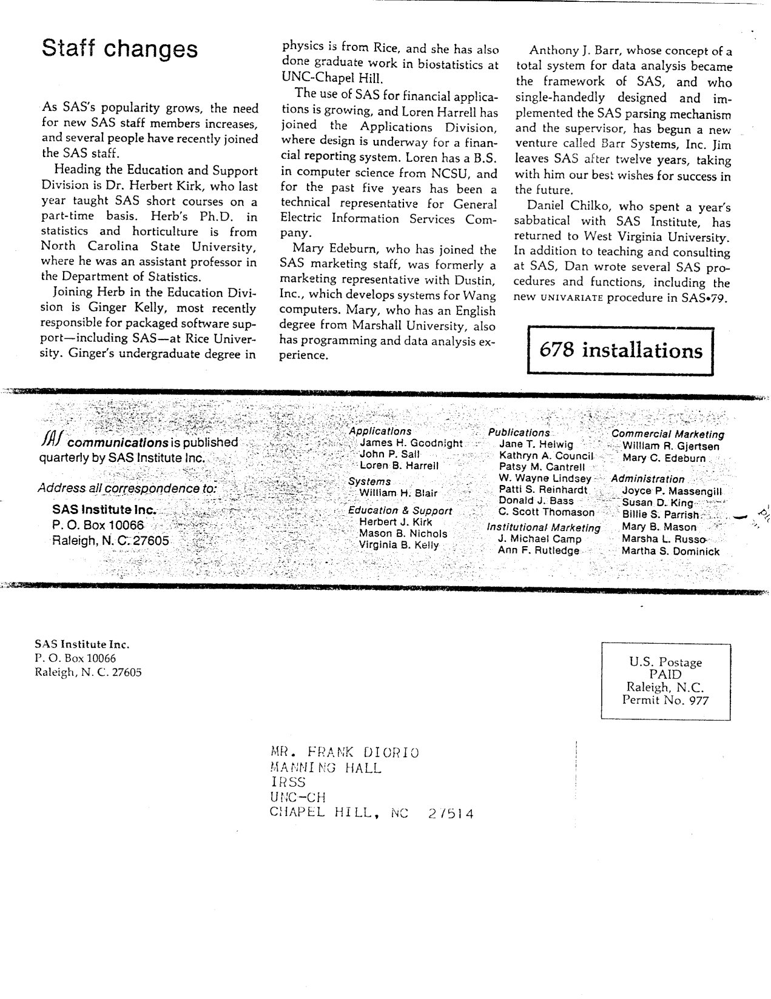

The fourth issue of Volume IV of "SAS Communications" was published in Spring 1979, weeks after SUGI '79 closed in Clearwater Beach. This is the last issue in the series. Highlights include a report on the conference (462 registrants against 241 the year before, fourteen invited and 70 contributed papers, and a best-presentation award for each of the six sessions), a survey of the technical environment at SAS sites - IMS, MVS, TSO, Tektronix tubes and Calcomp plotters - and the results of the SASware ballot, in which over 800 users each spent a notional $500 among 185 possible enhancements: a book of SAS examples came first, extended graphics second and the DO-WHILE statement third. Also in the issue: the performance-measurement and utility-industry user groups formed at the conference, the SUGI '80 call for papers in San Antonio, two worked examples of saving intermediate results - confidence intervals for means by region, and a normal probability plot of GLM residuals from PROC RANK - an iteratively reweighted least squares fit in PROC NLIN set against the LAV procedure, a consultant's corner on printing a "no observations" message for an empty data set, and four new SAS staff as Anthony J. Barr leaves to start Barr Systems. The original is <a href="../resources/SAS_Communications_issue_16.pdf" target="_blank">here</a>.

<hr/>



# **SAS Communications**

**Vol. IV, No. 4**  
**Spring 1979**

---

## **SAS Users Meet**

*Conference*

Enthusiasm and conversation were high at the fourth SUGI (SAS Users Group International) meeting in January, held this year in Clearwater Beach, Florida. SUGI '79 was the biggest and best yet, with almost 500 attendees and nearly 100 papers. Some scenes: registration desk swamped by waves of SAS users . . . SAS consultant Mason Nichols presenting Dr. Phil Miller with the User Feedback Award, an engraved plaque featuring a dead bug . . . standing room only for S.R. Searle's presentation . . . Jim Goodnight, Rudi Freund, and Herb Council pushing a catamaran through the surf . . . LAST.HELWIG unexpectedly introducing herself from the back row . . . Bill Blair breaking transparency-flipping speed records while condensing his presentation of new SAS features into 34 minutes . . . Rod Strand rushing among sessions to present all three of his papers . . . SUGI-green t-shirts provoking a stampede . . . the Gulf sunset and spirited conversation keeping 500 SAS users warm at the poolside mixer . . . join us next year!

## **Technical Environment At SAS Sites**

*Survey*

We wanted to learn more about the technical environment - data base management systems, operating systems, interactive services, and graphic devices - at SAS sites, so last fall we sent questionnaires to more than 500 SAS representatives. We also asked about the extent and nature of SAS usage at each site.

Almost three hundred usable responses were returned to us, and we would like to thank those who completed and returned the questionnaire.

Some highlights of our findings:

- Over half (52%) of those responding have or plan to acquire the IMS data base management system.
- MVS is the operating system used by a majority (56%) of those responding.
- Almost two-thirds (64%) have TSO.
- The most common graphics devices are the Tektronix tube (45%) and the Calcomp plotter (40%).
- In general application areas, SAS is used often for statistical analysis by 71% of those responding; for descriptive statistics by 68%; for data manipulation by 61%; for retrieval by 47%; and for report writing by 41%.
- In specific areas, SAS is used often for computer performance evaluation by 38%; for analysis of designed experiments by 36%; for social research by 28%; for forecasting and econometrics by 22%; and for business data processing by 21%.
- 94% reported that SAS usage is growing at their installations.

SAS Institute plans to use the results of this survey in making decisions about the future growth and development of SAS. If you'd like more specific information about the results of our survey, give SAS Institute a call.

## **Ballot Results**

*Users decide*

Over 800 SAS users participated in setting priorities for SAS improvements by sending SASware ballots to SAS Institute.

Users were asked to allocate $500 among 185 possible SAS enhancements. The top twenty items, based on total dollars spent, are listed below:

1. book of SAS examples
2. extended graphic capabilities
3. DO-WHILE statement
4. ability to reenter lines under TSO
5. IMS interface
6. table look-up or recode facility
7. ability to run under CMS
8. indexing system for SAS data sets
9. ability to read VSAM and BDAM files
10. improved understandability of GLM documentation
11. ability to define functions as in PL/I and FORTRAN
12. median, percentile estimates
13. more statistical methodology in documentation
14. symbolic parameters in MACROs
15. MACRO library facility
16. selection of observations within PROCs
17. TSO user's guide
18. more multiple comparison methods
19. guide to SMF processing
20. in PROC MEANS, ability to output in following format:

```
           X       Y       Z
MEAN      x.x     x.x     x.x
N         x.x     x.x     x.x
```

## **Chicago And Atlanta**

*Courses*

Chicago, Illinois and Atlanta, Georgia are the locations for the next SAS two-day short courses. The Chicago course will be held April 2-3 at the Continental Plaza; the Hyatt Regency is the location for the Atlanta course May 10-11.

Registration forms for these two courses have been mailed to everyone on the SAS Communications mailing list. If you'd like additional forms or more information, please call us at 919/834-4381.

Courses planned for the summer are in Washington, D.C. June 14-15, in Boston July 30-31, and in Raleigh August 20-21.

## **Writing Procedures**

*courses*

In addition to the courses mentioned above, a short course in writing SAS procedures is scheduled for Raleigh, North Carolina on May 17-18. This course is more technical in nature than the regular two-day course, and is intended for the programmer with a knowledge of FORTRAN or PL/I who wants to write his own SAS procedures.

Registration forms for the procedure-writing course will be mailed in early April.

## **Who To Call At SAS**

Many SAS users need to call SAS Institute from time to time. You can make your telephone call shorter by asking directly for the person who can solve your problem.

| If you want to... | ask for... |
| --- | --- |
| order manuals | Patsy Cantrell |
| register for a public short course | Billie Parrish |
| arrange an in-house short course | Herb Kirk |
| discuss your contract | Marsha Russo |
| add or change a name on our mailing list | Mary Mason |
| get help with a technical question | a technical consultant |

The SAS Institute phone number is 919/834-4381.

## **Annotated Output For GLM**

*unbalanced data*

Information is now available on the meaning of SAS GLM output for unequal subclass numbers (unbalanced) data. In a project directed by S.R. Searle at Cornell University, output generated by a series of small sets of unbalanced data processed through GLM and HARVEY has been extensively annotated with an explanation of what the output values are. These annotated computer outputs, in 8 1/2 x 11 form, are available for $5 each for GLM and HARVEY, and also for BMDP2V, SPSS ANOVA, and GENSTAT ANOVA. Orders will be mailed post-free from:

Biometrics Unit  
339 Warren Hall  
Cornell University  
Ithaca, NY 14853

upon receipt of $5 (US) for each annotated output ordered. Checks should be made payable to Cornell University.

## **SUGI '79**

*Helene Cavior, editor*

The fourth annual SAS Users Group International (SUGI) conference was held in Clearwater Beach, Florida, January 29-31, 1979. SAS's growth over the past year was reflected in the conference registration - 462 people compared with 241 at last year's conference. Special thanks go to the conference chairmen, William Wilson of the University of North Florida and Ramon Littell of the University of Florida; the session chairmen; and to SAS Institute, for a most informative and enjoyable conference.

Fourteen invited papers and 70 contributed papers were presented, and this year awards were given for the best presentation in each of the six sessions. The winners were:

**Business**  
William M. Parker  
North Central Texas Council of Governments

**Medical Applications**  
Richard A. Enz and Doron Steger  
American Hoechst Corporation

**SAS in the University**  
Douglas Cockrell and Ione Cockrell  
University of South Carolina

**Linear Models**  
Paul Stewart and Ronald W. Helms  
University of North Carolina

**Research Data Management**  
Michael P. Farrell, A. Dale Magoun, and Karen Daniels  
U.S. Army Corps of Engineers

**Statistics**  
Edward R. Jones  
Chevron Research Company

Honorable mentions were also awarded to Terry Therneau of the Mayo Clinic, in the Medical Applications session; Samuel G. Carmer and W.T. Hsieh of the University of Illinois, in the Linear Models session; and Marilyn Bodow of the College of Medicine and Dentistry of New Jersey, in the Research Data Management session.

The SUGI '79 Proceedings will be published in early spring. A copy will be mailed to each conference attendee - call Patsy Cantrell at SAS Institute to order additional copies.

---



## **Performance Measurement Group**

Evening mixers at SUGI '79 and birds-of-a-feather sessions gave additional opportunities for exchange of ideas. The birds-of-a-feather session on Performance Measurement and Capacity Planning resulted in the formation of a group to coordinate a SASware exchange of programs in this area. Anyone interested in participating should contact:

Pete Rikard  
User Services, Computing Center  
Virginia Commonwealth University  
1015 Floyd Avenue  
Richmond, VA 23285  
804/257-1582

or

Pete Kuchnicki  
Southwestern Bell  
St. Louis, MO 63102  
314/427-7178

or J. Michael Camp at SAS Institute.

## **Power Users Group**

The birds-of-a-feather session at SUGI '79 for users in the utility industry also resulted in the formation of a group to address specific application areas of concern, such as environmental data analysis, load forecasting, and support. Initially, a directory of utility SAS users will be distributed. Anyone interested in participating in this group should contact:

Joe Donaghy  
Carolina Power & Light  
411 Fayetteville Street  
PO Box 1551  
Raleigh, NC 27602  
919/836-7502

## **SUGI '80**

SUGI '80 is planned for San Antonio, Texas and will be chaired by Rudolph J. Freund of Texas A & M University. The sessions will be organized around usage areas rather than interest groups to minimize the problem of simultaneous sessions of interest. Next year's session chairmen:

Statistics  
Ed R. Jones, Chevron Research Company  
Don Henderson, USDA

Computer Performance  
Pete Kuchnicki, Southwestern Bell

Information Systems  
Ruth Ingram, Procter and Gamble

Training and Support of SAS  
Jan Curley, Ford Motor Company

In addition, SUGI '80 will feature a general poster session that will be coordinated by Helene Cavior of the Bureau of Prisons. The poster session will provide a more appropriate format for presentations describing procedures or macros.

Individuals wishing to participate in next year's conference should submit an abstract to the appropriate session chairman, who may recommend the poster session as an alternative to an oral presentation. It will remain the option of the author as to his method of presentation.

## **SASware Index**

Copies of the SASware Index were distributed at the conference and are also being distributed, upon request, by the SUGI editor.

Interest in copies of the SASware Index has been great, but the contributions have been slow in arriving. In order to increase the Index's usefulness, a committee has been formed to solicit contributions for all macros and procedures appearing in the SUGI proceedings. Helene Cavior heads the committee, and several SUGI members have volunteered to work with her. You can save the committee some work by sending a description of your proc or macro to:

Helen Cavior, SUGI Editor  
1921 Glenhaven Avenue  
Walnut Creek, CA 94595  
415/347-0725 (9:30-6:00 Pacific time)

Please use the following format:

```
- PROC or MACRO name
- Author's name and address
- Description (up to 50 words)
    (include what it does, how it does it, additional
    software or hardware required, and the cost
    for reproduction/distribution)
- Keywords (up to 5)
- Reference (if already published)
```

---

## **SAS Around The World**

*Agnar Hoskuldsson, European editor*

(Note: This column is the first contribution from Agnar Hoskuldsson of the Technical University of Denmark, who is the European editor for SAS Communications.)

## **Saving Intermediate Results**

You can use intermediate results from SAS procedures to compute statistics that aren't otherwise available in SAS. These results can be stored on disk or tape, then used as input to other proc steps. Two examples of using intermediate results are shown below: computing confidence intervals for mean values, and producing normal probability plots of residuals.

## **Confidence Intervals For Mean Values: Example 1**

The first lines in the SAS job contain JCL and the SAS statements necessary to read in the data from cards. Each data line contains the variables REGION and X1-X6. The OPTIONS statement requests that all results be printed using a linesize of 72.

```
//jobname JOB acct,name
// EXEC SAS
//A DD DSN=NAME1,DISP=OLD
OPTIONS LS=72;
DATA D;
INPUT REGION X1-X6;
CARDS;
data lines
```

In the next step, you sort the data, and compute means, standard errors, and the number of nonmissing values for each REGION. Since the goal is to save these results for later use, no printout from the MEANS procedure is needed.

```
PROC SORT; BY REGION;
PROC MEANS NOPRINT; BY REGION;
OUTPUT OUT=A.REGMEAN N=N1-N6
MEAN=M1-M6 STDERR=S1-S6;
```

The statistics you want are stored in the SAS data set REGMEAN in the OS data set with DSN=NAME1. You can now use this SAS data set containing means and standard errors to approximate confidence intervals for the mean value of X1 within each region:

```
DATA;
SET A.REGMEAN;
U_LIM = M1 + 1.96*S1;
L_LIM = M1 - 1.96*S1;
PROC PLOT;
PLOT M1*REGION='M'
U_LIM*REGION='U'
L_LIM*REGION='L'/OVERLAY
VPOS=30;
```

---



## **Normal Probability Plot Of Residuals: Example 2**

Suppose you want to study how your data fits the simple model X1=a+b*X3+c*X6. You can use GLM, outputting predicted and residual values into a SAS data set:

```
PROC GLM DATA=D;
MODEL X1=X3 X6 /P;
OUTPUT OUT=NEW1 PREDICTED=PX1
RESIDUAL=EX1;
```

The predicted values of X1, called PX1, are stored in the SAS data set NEW1. Residual values, the differences X1-PX1, are given the name EX1. The P option on the MODEL statement requests that individual predicted values and residuals be printed, making it easy to spot numerically large residuals. A normal probability plot of the residuals is produced by:

```
PROC RANK NORMAL=BLOM OUT=NEW2;
VAR EX1;
RANKS R;
PROC PLOT;
PLOT R*EX1 / VPOS=30;
```

If the residuals follow a normal distribution, the points would approximately follow a straight line.

## **Iteratively Reweighted Least Squares Using NLIN**

*technical*

SAS's NLIN procedure can be used to perform iteratively reweighted least squares (IRLS), a technique that is used to obtain more robust estimates than those obtained using other least squares methods.

One class of weight functions that has been proposed uses a power of the residuals of the last iteration:

W=ABS(RESIDUAL)**P where P is between 1 and 2

This weight function results in estimates that minimize the L<sub>p</sub> norm of the residuals:

MINIMIZE &Sigma; |y<sub>i</sub> - X<sub>i</sub>&beta;|<sup>P</sup>

---



The L<sub>2</sub> norm estimates have weights equal to 1, and are the usual least squares estimates produced by GLM. The L<sub>1</sub> norm estimates minimize the sum of the absolute values of the residuals, and are the estimates computed by the user-contributed SAS procedure LAV. The L<sub>1.5</sub> norm estimates are a compromise between the L<sub>2</sub> least squares estimates and the more robust L<sub>1</sub> LAV estimates.

The `_WEIGHT_` statement in NLIN can be used to specify weights that are functions of the predicted or residual values from the previous iteration.

IRLS was used to compute the L<sub>1.5</sub> estimates of a quadratic time trend model of the United States population from 1790 to 1970. In order to compare estimates, L<sub>1</sub> estimates were computed using GLM, and L<sub>2</sub> estimates using LAV:

```
PROC GLM;
MODEL POP = YEAR YEARSQ;
PROC LAV;
MODEL POP = YEAR YEARSQ;
PROC NLIN;
PARMS B0=0 B1=0 B2=0;
FITTED = B0 + B1*YEAR + B2*YEARSQ;
MODEL POP=FITTED;
DER.B0=1; DER.B1=YEAR;
DER.B2 = YEARSQ;
_WEIGHT_ = 1/SQRT(ABS(POP - FITTED));
```

The IRLS process converged in 13 iterations. A residual data set was generated by running the procedures and creating output data sets, then merging the residual values. In the plot, L<sub>1</sub> residuals are marked "1", L<sub>2</sub> residuals are marked "2" and L<sub>1.5</sub> residuals are marked "5". Note the year values of 1940 and 1950 were outliers in the population trend. These outliers influence the L<sub>2</sub> fit more than the other more robust fits.

For more information about iteratively reweighted least squares, see:

Holland and Welsch, "Robust Regression Using Iteratively Reweighted Least Squares," Communications in Statistics A6(9), 1977, pp 813-827.

and

Kennedy and Gentle, "Comparisons of Algorithms for Minimum L<sub>p</sub> Norm Regression," Tenth Annual Symposium on the Interface, NBS Publication 503, 1977.

For details on the user-contributed LAV procedure, see Gentle and Lee, SAS Technical Report S-101.

## **Consultant's Corner**

*Q:* I am writing a SAS program to produce a weekly report. Each week, the job reads data from a file and creates separate SAS data sets, each with a different value of the variable TYPE. When I run this job, some values of TYPE will not be present in that week's data file. I still want to print a report, but with a message saying that there are no records for that week. How can I handle this problem using SAS?

*A:* Consider the following job:

```
//jobname JOB acct,name
// EXEC SAS
//IN DD DSN=...
DATA A B C;
INFILE IN;
INPUT TYPE $1. ...;
IF TYPE='A' THEN OUTPUT A;
IF TYPE='B' THEN OUTPUT B;
IF TYPE='C' THEN OUTPUT C;
DATA _NULL_;
FILE PRINT;
IF EOF AND _N_=1 THEN
PUT 'NO OBSERVATIONS OF TYPE=A';
SET A END=EOF;
PUT ...;
similar report-writing steps for data sets B and C
```

In this example, three SAS data sets are created from the weekly file. If there are no TYPE=A observations in a given week, the SAS data set A will be empty. The END= option causes the variable EOF to be set to 1 when the next execution of the SET statement will fail, and so when there are no observations the value of EOF is set to 1 initially. Thus, when both EOF=1 and `_N_`=1, the message "NO OBSERVATIONS OF TYPE=A" is printed on the report.

This technique works for all methods of input: SET, MERGE, UPDATE, and INFILE. The rule is:

> SAS continues to execute statements in a DATA step until a SET, MERGE, UPDATE, or INPUT statement fails because the end of the data set or file has been reached.

---



## **Staff Changes**

As SAS's popularity grows, the need for new SAS staff members increases, and several people have recently joined the SAS staff.

Heading the Education and Support Division is Dr. Herbert Kirk, who last year taught SAS short courses on a part-time basis. Herb's Ph.D. in statistics and horticulture is from North Carolina State University, where he was an assistant professor in the Department of Statistics.

Joining Herb in the Education Division is Ginger Kelly, most recently responsible for packaged software support - including SAS - at Rice University. Ginger's undergraduate degree in physics is from Rice, and she has also done graduate work in biostatistics at UNC-Chapel Hill.

The use of SAS for financial applications is growing, and Loren Harrell has joined the Applications Division, where design is underway for a financial reporting system. Loren has a B.S. in computer science from NCSU, and for the past five years has been a technical representative for General Electric Information Services Company.

Mary Edeburn, who has joined the SAS marketing staff, was formerly a marketing representative with Dustin, Inc., which develops systems for Wang computers. Mary, who has an English degree from Marshall University, also has programming and data analysis experience.

Anthony J. Barr, whose concept of a total system for data analysis became the framework of SAS, and who single-handedly designed and implemented the SAS parsing mechanism and the supervisor, has begun a new venture called Barr Systems, Inc. Jim leaves SAS after twelve years, taking with him our best wishes for success in the future.

Daniel Chilko, who spent a year's sabbatical with SAS Institute, has returned to West Virginia University. In addition to teaching and consulting at SAS, Dan wrote several SAS procedures and functions, including the new UNIVARIATE procedure in SAS 79.

**678 installations**

---



---

SAS Communications is published quarterly by SAS Institute Inc.

James H. Goodnight, Applications  
John P. Sall, Applications  
Loren B. Harrell, Applications  
William H. Blair, Systems  
Herbert J. Kirk, Education & Support  
Mason B. Nichols, Education & Support  
Virginia B. Kelly, Education & Support  
Jane T. Helwig, Publications  
Kathryn A. Council, Publications  
Patsy M. Cantrell, Publications  
W. Wayne Lindsey, Publications  
Patti S. Reinhardt, Publications  
Donald J. Bass, Publications  
C. Scott Thomason, Publications  
J. Michael Camp, Institutional Marketing  
Ann F. Rutledge, Institutional Marketing  
William R. Gjertsen, Commercial Marketing  
Mary C. Edeburn, Commercial Marketing  
Joyce P. Massengill, Administration  
Susan D. King, Administration  
Billie S. Parrish, Administration  
Mary B. Mason, Administration  
Marsha L. Russo, Administration  
Martha S. Dominick, Administration

Address all correspondence to SAS Institute Inc., Post Office Box 10066, Raleigh, NC 27605.

---

SAS Institute Inc. - Post Office Box 10066 - Raleigh, North Carolina 27605 - (919) 834-4381

SAS user-group conference papers - every SUGI/SGF year from 1976 to 2021 among them - are indexed in [SAS Lexicon](https://saslexicon.org/index.html), Lex Jansen's archive of SAS user-group proceedings.

<!--
Spring 1979 - the issue that closed the books on SUGI '79 and opened the call for SUGI '80 in San Antonio.

The conference report counts 462 registrants against 241 a year earlier, with fourteen invited and 70 contributed papers, and for the first time gives a best-presentation award in each of the six sessions: Parker of the North Central Texas Council of Governments for business, Enz and Steger of American Hoechst for medical applications, the Cockrells of South Carolina for SAS in the university, Stewart and Helms of UNC for linear models, Farrell, Magoun and Daniels of the Army Corps of Engineers for research data management, and Ed Jones of Chevron for statistics. Honorable mentions go to Terry Therneau, Carmer and Hsieh, and Marilyn Bodow.

The SASware ballot drew over 800 users, each spending a notional $500 against 185 possible enhancements. A book of SAS examples tops the list, ahead of extended graphics and the DO-WHILE statement, with the IMS interface, re-entering lines under TSO, table look-up and a CMS interpreter rounding out the top seven.

The survey of the technical environment - roughly 300 responses - puts IMS at 52%, MVS at 56%, TSO at 64%, the Tektronix tube at 45% and the Calcomp plotter at 40%, and finds 94% of sites reporting growing SAS usage.

Also inside: two user groups formed at the conference (performance measurement and capacity planning, and the utility industry), a detailed confidence-interval example built from PROC MEANS output, a normal probability plot of GLM residuals via PROC RANK with NORMAL=BLOM, an iteratively reweighted least squares fit in PROC NLIN compared against the LAV procedure on US population 1790-1970, a consultant's corner on printing a "no observations" message, four new staff - Kirk, Kelly, Harrell and Edeburn - the departure of Anthony J. Barr to found Barr Systems, and 678 installations.

Transcribed from the original newsletter, published by SAS Institute Inc., for historical interest.

#sas #sugi #sugi79 #sugi80 #procmeans #procnlin #procplot #statisticalsoftware #techhistory #retrocomputing #sasinstitute
-->
